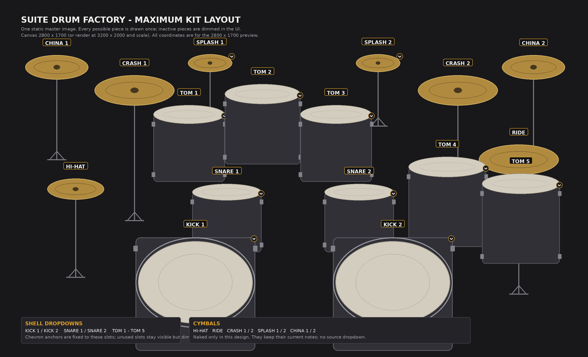

# Maximum kit art layout

This is the layout for a single master kit image that shows every selectable
piece at once. The UI dims pieces that are disabled or not present in the
current configuration; it does not need to reflow the image.

## Canvas

- Render at **3200 × 2000** (1.6:1), or 4096 × 2560 for extra detail.
- Transparent PNG. Keep 80–120 px clear margin on all sides.
- Front three-quarter view, one consistent light source, one floor line.
- Do not bake labels, chevrons or piece names into the art. The UI draws those.
- The preview above is 2800 × 1700; coordinates below are normalised, so they
  scale to any canvas.

## Piece inventory

Seventeen slots are needed to cover every configuration:

| Slot | Type | Why it exists |
| :-- | :-- | :-- |
| Kick 1 | shell | main kick |
| Kick 2 | shell | Crocell KDrumL/R is a double kick |
| Snare 1 | shell | main snare |
| Snare 2 | shell | Naked has Snare 1 and Snare 2 |
| Tom 1–5 | shell | Naked has five toms; Crocell has four |
| Hi-hat | cymbal | Naked only |
| Ride | cymbal | Naked only |
| Crash 1 | cymbal | Naked only |
| Crash 2 | cymbal | Naked only |
| Splash 1 | cymbal | Naked only |
| Splash 2 | cymbal | Naked only |
| China 1 | cymbal | Naked only |
| China 2 | cymbal | Naked only |

If Crocell is not selected, Kick 2 is dimmed. If the snare source has only one
snare, Snare 2 is dimmed. The slots stay in place so the dropdown anchors and
hit regions never move.

## Normalised layout

`x` and `y` are the piece centre as a fraction of canvas width/height. `w` is
the piece width as a fraction of canvas width.

| Slot | x | y | w | Notes |
| :-- | --: | --: | --: | :-- |
| Kick 1 | 0.332 | 0.788 | 0.204 | primary kick, centred-left |
| Kick 2 | 0.668 | 0.788 | 0.204 | double-kick partner |
| Snare 1 | 0.386 | 0.594 | 0.118 | sits between kick and player |
| Snare 2 | 0.611 | 0.594 | 0.118 | auxiliary snare |
| Tom 1 | 0.321 | 0.382 | 0.121 | high rack tom |
| Tom 2 | 0.446 | 0.329 | 0.129 | centre rack tom |
| Tom 3 | 0.571 | 0.382 | 0.121 | low rack tom |
| Tom 4 | 0.761 | 0.535 | 0.132 | floor tom |
| Tom 5 | 0.886 | 0.582 | 0.132 | second floor tom |
| Hi-hat | 0.129 | 0.529 | 0.096 | far left |
| Ride | 0.882 | 0.447 | 0.136 | right, above floor toms |
| Crash 1 | 0.229 | 0.253 | 0.136 | upper left |
| Crash 2 | 0.779 | 0.253 | 0.136 | upper right |
| Splash 1 | 0.357 | 0.176 | 0.075 | upper centre-left |
| Splash 2 | 0.643 | 0.176 | 0.075 | upper centre-right |
| China 1 | 0.096 | 0.188 | 0.107 | far upper left |
| China 2 | 0.907 | 0.188 | 0.107 | far upper right |

## Dropdown anchors

- One fixed anchor per **shell** piece: Kick 1, Kick 2, Snare 1, Snare 2,
  Tom 1–5.
- Anchor position: top-right of the piece's visual bounds, inset about 18 px.
- Cymbals have no source menu; they keep fixed Naked samples.
- A disabled piece keeps its anchor. The anchor shows the current source or
  "Off".
- Store anchors as normalised points in the kit metadata, not as pixels.

## Hit regions and dimming

A single flat PNG cannot dim or hide one piece by itself. The art needs either:

1. **Per-piece polygon hit regions** in normalised coordinates, plus a dark
   translucent overlay drawn over the inactive region, or
2. **One alpha mask per piece**, used for hit testing and for drawing the dim
   overlay.

Polygon regions are simpler for a 17-piece kit. The region only needs to cover
the visible silhouette of each drum/cymbal; it does not need to be pixel exact.

## Z-order, back to front

1. China 1, China 2
2. Crash 1, Crash 2
3. Splash 1, Splash 2
4. Hi-hat, Ride
5. Tom 1–3
6. Tom 4–5
7. Snare 1–2
8. Kick 1–2

Cymbal stands should sit behind the shells. Floor-tom legs sit in front of the
floor-tom shells but behind the snares and kicks.

## Why one image works

- No reflow when a source changes; the kit always looks like the same kit.
- Dropdown anchors stay in exactly the same place.
- Hit testing is a fixed set of 17 regions.
- Inactive pieces are dimmed rather than removed, which makes it obvious what
  is available and avoids holes in the artwork.

The trade-off is that a Naked-only kit still shows the double-kick and second
snare silhouettes, dimmed. If that is visually undesirable, the alternative is
separate piece sprites (the current approach) or several pre-composed images
for common configurations.
