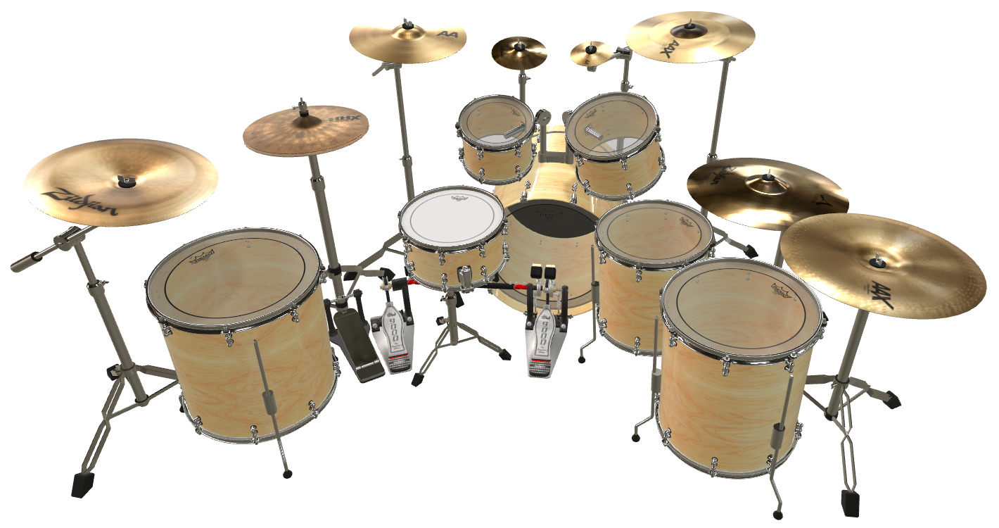

# Drum Factory master image

The plugin uses one master image plus fixed piece regions. There is no reflow:
disabled pieces stay in place and are dimmed.

## Canvas

- Source image: 1576 × 897 RGBA, cropped to 1420 × 750 for the plugin asset.
- White outline baked around the alpha silhouette.
- Coordinates below are normalised to the 1300 × 700 crop.
- The UI draws labels, hit dots and dropdown chevrons; they are not in the art.

## Visible pieces

15 regions:

| Slot | Notes |
| :-- | :-- |
| Kick | one kick, double pedal |
| Snare | one snare |
| Tom 1 | rack tom, centre-left |
| Tom 2 | rack tom, centre-right |
| Tom 3 | floor tom, centre-right |
| Tom 4 | floor tom, right |
| Tom 5 | floor tom, left |
| Hi-hat | small cymbal, left of the snare |
| Ride | large cymbal, far right |
| Crash 1 | upper left |
| Crash 2 | upper right |
| Splash 1 | small, upper centre-left |
| Splash 2 | small, upper centre-right |
| China 1 | darker cymbal, right |
| China 2 | large cymbal, far left |

## Region rules

- Each piece has a normalised click ellipse (head or cymbal surface).
- Each shell has a larger body rectangle used only for the disabled dim.
- Disabled pieces are currently left fully visible. Exact dimming needs
  per-piece masks; the earlier approximate overlays were removed.
- Whole drum bodies are clickable, not just the heads.
- Hit dots sit at the centre of the playing surface.
- Shell chevrons sit at the top-right of the piece region.
- Cymbals have no source dropdown.

The live values are in `src/ui/DrumKitView.cpp`
(`singleImageRegions`, `singleImageBodies`, `singleImageHitPoints`).
